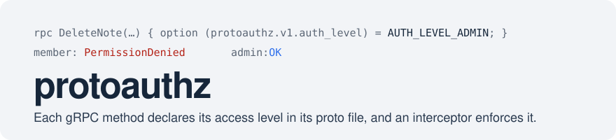
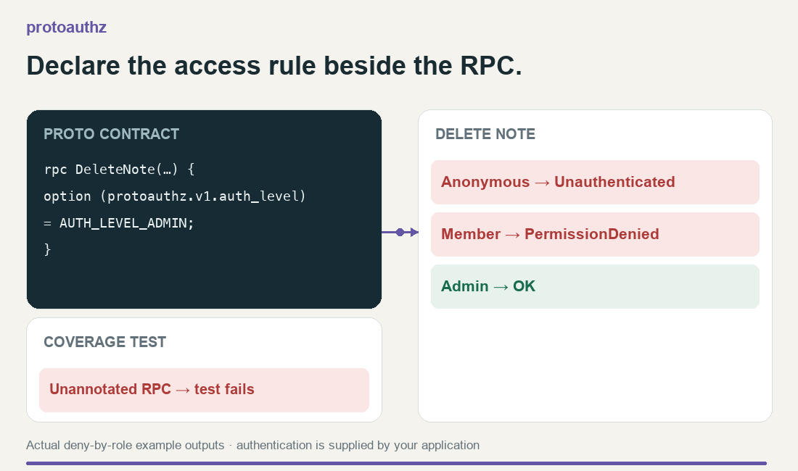
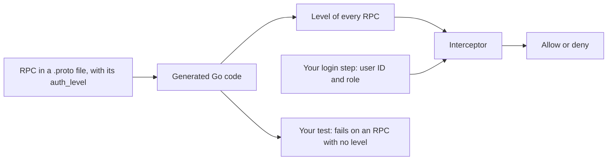

<picture>
  <source media="(prefers-color-scheme: dark)" srcset=".github/assets/banner-dark.svg">
  
</picture>

[](LICENSE)
[](go.mod)

<a href="https://www.producthunt.com/products/agentic-workflow-kit?embed=true&amp;utm_source=badge-featured&amp;utm_medium=badge&amp;utm_campaign=badge-tetriz-engineering-kit" target="_blank" rel="noopener noreferrer"></a>

In a Go gRPC service that checks access by hand inside each handler, a new RPC that misses its
check is served to every caller, and no test or build points it out. protoauthz denies an RPC
with no level by default, and a test helper fails your tests until every RPC has one.



An admin-only RPC denies anonymous and member calls; a test catches missing annotations. [Demo details](.github/assets/demo/README.md).

## How it works

<details>
<summary>Implementation flow</summary>



You set each RPC's access level beside it in the proto file, so a change to it shows in the proto
diff. At startup, protoauthz reads every level from the generated code linked into your binary.

Your login step is your own interceptor. It checks the token and records the caller. For each
call, protoauthz compares that caller with the RPC's level and allows or denies it.


</details>

## Quick start

Needs Go 1.26 or later. This demo needs no code generator or service, because the module ships
its example notes service already generated.

1. Make a module and fetch protoauthz:

   ```sh
   mkdir quickstart && cd quickstart
   go mod init quickstart
   go get github.com/tetriz-ai/protoauthz@latest
   ```

2. Save this program as `main.go` and run `go run .`:

   ```go
   // This program checks three callers against DeleteNote, an admin-only
   // RPC in the example's proto file.
   package main

   import (
   	"context"
   	"fmt"

   	"google.golang.org/grpc"
   	"google.golang.org/grpc/status"

   	"github.com/tetriz-ai/protoauthz"
   	_ "github.com/tetriz-ai/protoauthz/gen/protoauthz/example/v1" // registers the example service
   )

   func main() {
   	authz := protoauthz.NewAuthLevelInterceptor(protoauthz.LoadAuthLevelsFromRegistry(), nil)
   	info := &grpc.UnaryServerInfo{FullMethod: "/protoauthz.example.v1.NoteService/DeleteNote"}
   	deleteNote := func(context.Context, any) (any, error) { return "deleted", nil }

   	anonymous := context.Background()
   	member := protoauthz.WithRole(protoauthz.WithUserID(anonymous, "u-1"), protoauthz.RoleMember)
   	admin := protoauthz.WithRole(protoauthz.WithUserID(anonymous, "u-2"), protoauthz.RoleAdmin)
   	for _, ctx := range []context.Context{anonymous, member, admin} {
   		_, err := authz(ctx, nil, info, deleteNote)
   		fmt.Println(status.Code(err))
   	}
   }
   ```

   The anonymous caller and the member are denied, and the admin gets through:

   ```text
   Unauthenticated
   PermissionDenied
   OK
   ```

The program calls the interceptor directly to show its decision. In your own service,
[annotate your RPCs](docs/usage.md#annotate-your-rpcs), then wire the interceptor into a server
as [Common tasks](#common-tasks) shows.

## What's in the box

| Use | When you want to |
|---|---|
| The `auth_level` proto option | [Declare who may call an RPC](#annotate-an-rpc), beside it in its proto file |
| `NewAuthLevelInterceptor` and `NewAuthLevelStreamInterceptor` | [Enforce the levels on a server](#enforce-the-levels-on-a-server) |
| `WithUserID`, `WithRole`, `WithEmail` | [Record the caller](docs/reference.md#the-caller-in-the-context) in your login step |
| `protoauthztest.RequireAuthLevels` | [Fail a test when an RPC has no level](#fail-a-test-on-a-missing-level) |
| `NewLadder` | [Use role names of your own](docs/usage.md#use-your-own-roles) |
| `AUTH_LEVEL_ALLOWLIST` and a callback | [Admit a named set of people](docs/usage.md#admit-a-named-set-of-people), whatever their role |
| Prefixes on the interceptor | [Deny unannotated RPCs in your own packages only](docs/usage.md#deny-unannotated-rpcs-under-a-prefix), so health checks pass |

The other functions, such as `LoadAuthLevelsFromRegistry` and `UnauthenticatedMethods`, are in
[reference.md](docs/reference.md).

### What it does not do

- **Authenticate.** That stays with your login step.
- **Store roles or allow-lists.** Your login step and your callback supply them.
- **Check request fields.** It decides per RPC, not per record asked for.

## Common tasks

### Annotate an RPC

Your own service needs a code generator, such as buf with protoc-gen-go and protoc-gen-go-grpc.
Set a level on each method, as in this `proto/example/v1/notes.proto`, after the copy and
`buf.gen.yaml` steps in [Annotate your RPCs](docs/usage.md#annotate-your-rpcs):

```proto
syntax = "proto3";

package example.v1;

import "protoauthz/v1/auth_level.proto";

option go_package = "example.com/notes/gen/example/v1;examplev1";

service NoteService {
  rpc DeleteNote(DeleteNoteRequest) returns (DeleteNoteResponse) {
    option (protoauthz.v1.auth_level) = AUTH_LEVEL_ADMIN;
  }
}

message DeleteNoteRequest {}

message DeleteNoteResponse {}
```

### Enforce the levels on a server

Chain unary and stream login steps that look up bearer tokens before protoauthz, as the full
[grpc-server-with-login](examples/grpc-server-with-login/) program does:

```go
// Command server wires a login step and protoauthz into a gRPC server.
package main

import (
	"context"
	"fmt"
	"strings"

	"google.golang.org/grpc"
	"google.golang.org/grpc/codes"
	"google.golang.org/grpc/metadata"
	"google.golang.org/grpc/status"

	"github.com/tetriz-ai/protoauthz"
	examplev1 "github.com/tetriz-ai/protoauthz/gen/protoauthz/example/v1"
)

// sessions maps a bearer token to a user ID. Yours checks a real session.
var sessions = map[string]string{"token-jane": "u-1"}

// loginContext verifies the token for both unary and streaming calls.
func loginContext(ctx context.Context) (context.Context, error) {
	if tokens := metadata.ValueFromIncomingContext(ctx, "authorization"); len(tokens) > 0 {
		userID, ok := sessions[strings.TrimPrefix(tokens[0], "Bearer ")]
		if !ok {
			return nil, status.Error(codes.Unauthenticated, "unknown token")
		}
		ctx = protoauthz.WithRole(protoauthz.WithUserID(ctx, userID), protoauthz.RoleMember)
	}
	return ctx, nil
}

func login(ctx context.Context, req any, _ *grpc.UnaryServerInfo, handler grpc.UnaryHandler) (any, error) {
	ctx, err := loginContext(ctx)
	if err != nil {
		return nil, err
	}
	return handler(ctx, req)
}

type streamWithContext struct {
	grpc.ServerStream
	ctx context.Context
}

func (s streamWithContext) Context() context.Context { return s.ctx }

func streamLogin(srv any, stream grpc.ServerStream, _ *grpc.StreamServerInfo, handler grpc.StreamHandler) error {
	ctx, err := loginContext(stream.Context())
	if err != nil {
		return err
	}
	return handler(srv, streamWithContext{stream, ctx})
}

func main() {
	levels := protoauthz.LoadAuthLevelsFromRegistry()
	server := grpc.NewServer(
		grpc.ChainUnaryInterceptor(login, protoauthz.NewAuthLevelInterceptor(levels, nil)),
		grpc.ChainStreamInterceptor(streamLogin, protoauthz.NewAuthLevelStreamInterceptor(levels, nil)),
	)
	examplev1.RegisterNoteServiceServer(server, examplev1.UnimplementedNoteServiceServer{})
	fmt.Println("public:", protoauthz.UnauthenticatedMethods(levels))
	// Serve with server.Serve(listener) from here.
}
```

It prints the one public RPC and exits before serving:

```text
public: [/protoauthz.example.v1.NoteService/GetVersion]
```

### Fail a test on a missing level

Pass the generated file descriptor of each proto file that defines a service. This is
[annotations_test.go](examples/find-unannotated-rpcs/annotations_test.go):

```go
package main

import (
	"testing"

	examplev1 "github.com/tetriz-ai/protoauthz/gen/protoauthz/example/v1"
	"github.com/tetriz-ai/protoauthz/protoauthztest"
)

// TestEveryRPCHasAnAuthLevel is the test to put in your own service's suite.
// It fails naming each RPC with no usable auth_level. Pointed at the
// example's draft notes service, which leaves DeleteNote without a level, it
// fails with:
//
//	/protoauthz.example.draft.v1.NoteService/DeleteNote has no usable (protoauthz.v1.auth_level) option
func TestEveryRPCHasAnAuthLevel(t *testing.T) {
	protoauthztest.RequireAuthLevels(t, examplev1.File_protoauthz_example_v1_notes_proto)
}
```

## Limitations

- **Install both interceptor chains.** Unary interceptors do not check streaming RPCs; each chain needs its own login step followed by the matching protoauthz interceptor.
- **Your login step is trusted.** Never record a client-sent header as the caller's user ID or role.
- **Calls that bypass the `grpc.Server` skip every check.** Point grpc-gateway at a client connection, not `RegisterXxxHandlerServer`.
- **With prefixes, unannotated RPCs outside them pass.** Annotate those, or pass no prefixes.
- **A mistyped prefix lets every unannotated RPC through.** Test the same prefixes with `RequireAuthLevelsFromRegistry`.
- **A stream is checked once, when it opens.** Close a caller's open streams yourself when you revoke a role.
- **Roles are exact strings.** Record each role as your role list spells it: `Admin` is not `admin`.

[docs/limitations.md](docs/limitations.md) describes design limits, the harmful ones first.

## More

- [docs/reference.md](docs/reference.md): every level, status code, error message and prefix rule.
- [docs/usage.md](docs/usage.md): annotation setup, your own roles, allow-lists and prefixes.
- [examples/](examples/README.md): six runnable programs, none needing a service.
- [pkg.go.dev](https://pkg.go.dev/github.com/tetriz-ai/protoauthz): the full API.
- [CONTRIBUTING.md](CONTRIBUTING.md): the checks CI runs. Every change needs a test.
- [SECURITY.md](SECURITY.md): report a vulnerability privately.
- [LICENSE](LICENSE): MIT. Third-party material is listed in [NOTICE](NOTICE).

protoauthz follows [Semantic Versioning](https://semver.org/), and [CHANGELOG.md](CHANGELOG.md)
records each release. Before v1.0 a minor release may break the API.
[docs/reference.md](docs/reference.md#versioning-and-compatibility) says what counts as breaking and
how stable the proto is.

Copyright 2026 Workloom Solutions Private Limited. Contributors are listed in
[CONTRIBUTORS.md](CONTRIBUTORS.md).
